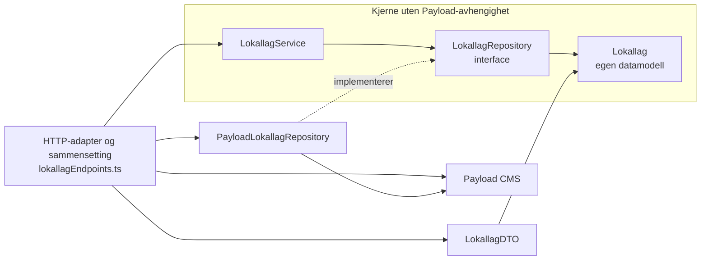
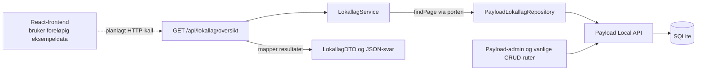

# Kodearkitektur for lokallag

Lokallagsoversikten har en heksagonal-inspirert oppdeling der applikasjonslogikken avhenger av et repository-grensesnitt, mens en adapter utfører spørringene i Payload. Dette gir et konkret eksempel på Dependency Injection, DTO-er og ansvarsdeling som gruppen kan bruke i arbeidet med oblig 6.2.

Eksempelet er implementert for `GET /api/lokallag/oversikt`. Kurs, nyheter, innholdsredigering og Payloads vanlige CRUD-ruter bruker fortsatt det eksisterende Payload-oppsettet. Frontenden bruker fortsatt eksempeldata. Backend er én applikasjon som kjøres samlet, selv om kildekoden nå har flere ansvarsområder.

## Kjernen og adapterne

Heksagonal arkitektur handler om å gjøre kjernen uavhengig av teknologiene rundt den. Antall sider i tegningen bestemmer ikke antall moduler. En port er en avtale om en operasjon; en adapter oversetter mellom avtalen og en bestemt teknologi.

`LokallagService` er inngangen til denne modulens applikasjonslogikk. `LokallagRepository` er en utgående port for å hente data. `PayloadLokallagRepository` implementerer porten ved hjelp av Payload. HTTP-endepunktet er en inngående adapter og kobler sammen service og repository. Frontenden er en klient som senere kan kalle dette endepunktet.

Lokallag har foreløpig enkel lesefunksjonalitet. Servicen validerer paginering og beregner antall sider; den inneholder ennå ingen avanserte forretningsregler. Regler om kurskapasitet eller publisering må utvikles når de aktuelle funksjonene innføres.

## Filer og ansvar

Alle relative filstier i tabellen starter i `Backend/src/modules/lokallag/`.

| Fil | Ansvar |
| --- | --- |
| `domain/Lokallag.ts` | Beskriver lokallag med egne typer, uten Payload-importer. |
| `application/LokallagRepository.ts` | Definerer kontrakten for datatilgang og resultatet av en sidespørring. |
| `application/LokallagService.ts` | Gjennomfører brukstilfellet og validerer sidetall og sidestørrelse. |
| `adapters/PayloadLokallagRepository.ts` | Henter data gjennom Payload, respekterer tilgangsregler og mapper dokumentene til kjernens modell. |
| `http/LokallagDTO.ts` | Avgrenser hvilke lokallagsfelt oversikten sender til klienten. |
| `http/lokallagEndpoints.ts` | Leser HTTP-parametere, setter sammen avhengighetene og lager JSON- og feilsvar. |

Den eksisterende `Backend/src/collections/Lokallag.ts` registrerer endepunktet og beholder ansvaret for Payloads felter, admininnstillinger og tilgangsregler.

## Avhengigheter i kildekoden

Heltrukne piler nedenfor betyr at kode bruker eller importerer en annen del. Pilen merket «implementerer» viser at adapteren oppfyller repository-grensesnittet. Kjernen importerer ikke HTTP-adapteren, Payload-adapteren eller rammeverket.



HTTP-adapteren kjenner begge implementasjonene fordi den også fungerer som stedet der avhengighetene settes sammen. For en større applikasjon kan denne sammensettingen flyttes til en egen fabrikk. En ekstra fabrikk gir liten verdi for dette ene brukstilfellet.

## Forespørsel og dataflyt

Dette diagrammet viser hva som skjer når endepunktet kalles. Her betyr pilene kjøring og dataflyt, ikke retningen på TypeScript-importene. Den stiplede forbindelsen fra frontenden er planlagt.



## Koblingsgrad og avveininger

Tett kobling betyr at en del av koden kjenner detaljer i en annen del. Adapteren kjenner for eksempel Payloads `find`, samlingsnavnet `lokallag` og feltene i samlingen. Et rammeverksbytte krever derfor endringer i adapteren. Denne koblingen er tilsiktet fordi adapterens oppgave er å håndtere teknologien.

Servicen kjenner bare `findPage` og våre egne typer. En test kan levere et repository som returnerer data fra minnet, uten å starte Payload eller SQLite. Dette er løsere kobling. Det finnes fortsatt en avhengighet til kontrakten: Endres `findPage`, må både service, adapter og testimplementasjon vurderes.

Fordelen er at endringer i Payloads spørringsformat kan håndteres i adapteren uten å endre servicen, så lenge kontrakten beholdes. Kostnaden er flere filer og eksplisitt mapping. I et lite CRUD-prosjekt kan dette være mer struktur enn funksjonaliteten trenger. Her er oppdelingen også et avgrenset læringseksempel. Hele CMS-et omskrives ikke til egne services og repositories.

## DI og DTO i eksempelet

Dependency Injection skjer når HTTP-adapteren gir servicen repository-objektet:

```ts
const repository = new PayloadLokallagRepository(req)
const service = new LokallagService(repository)
```

Servicens konstruktør krever bare `LokallagRepository`. Testene kan derfor gi den et annet objekt med samme metode. Det trengs ingen DI-container eller ekstra bibliotek.

`LokallagDTO` bygger et nytt objekt med `id`, `name`, `region` og `description`. Adresse, kontaktfelter, tidsstempler og Payload-spesifikk struktur inngår ikke i denne oversikten. DTO-en holder API-formatet tydelig; tilgangskontroll håndteres separat. De vanlige Payload-rutene finnes fortsatt og har sine egne svarformater.

Adapteren bruker `overrideAccess: false` og sender med forespørselen. Dermed følger datatilgangen samlingens leseregler også når den nye ruten brukes. [Payloads Local API](https://payloadcms.com/docs/local-api/overview) omgår ellers tilgangskontroll som standard.

## API og tester

Eksempel på forespørsel etter at backend er startet:

```text
GET http://localhost:3000/api/lokallag/oversikt?page=1&pageSize=20
```

Svaret har formen nedenfor. Dataene er illustrative:

```json
{
  "items": [
    { "id": "1", "name": "Testlaget", "region": "Østfold", "description": "Et eksempel" }
  ],
  "page": 1,
  "pageSize": 20,
  "totalItems": 1,
  "totalPages": 1
}
```

`page` er et positivt heltall. `pageSize` er et heltall fra 1 til 100 og har standardverdi 20. Ugyldige parametere gir HTTP 400. Oversikten sorteres på navn og deretter ID. ID-er normaliseres til tekst. Når ingen lokallag finnes, er `items` tom og `totalPages` er 0. En side etter siste treff gir en tom `items`-liste og beholder det totale antallet treff.

Kjør fra `Backend`:

```bash
npm run test:unit
npm run test:lokallag
npm run lint
```

Enhetstestene kjører uten miljøfiler, Payload og database. Integrasjonstestene oppretter og fjerner sin egen midlertidige SQLite-database og sender forespørsler gjennom Payloads REST-ruting. De kontrollerer DTO-format, paginering, ugyldige parametere og at nektet lesetilgang gir 403. Oppsettet bruker [Payloads støtte for egne endepunkter](https://payloadcms.com/docs/rest-api/overview#custom-endpoints).

## Forslag til fordeling i gruppen

Fordel eierskap etter funksjonsområde, slik at hver utvikler kan arbeide med en sammenhengende funksjon og dens tester.

| Person | Foreslått hovedansvar | Konkret neste leveranse |
| --- | --- | --- |
| Magomed | Lokallag, felles arkitektur og API-avtaler | Gjennomgå eksempelet og forklare DI, DTO og avhengighetsretning for gruppen. Avtale API-format med frontend. |
| Jovan | Kursmodulen | Utarbeide kursoversikt med service, repository, DTO og tester etter samme mønster, når kursreglene er avklart. |
| Abdullahi | Nyhetsmodulen | Utarbeide nyhetsoversikt med service, repository, DTO og tester, inkludert publiseringsregler når disse er avklart. |

Hver utvikler har ansvar for API, logikk, datatilgang og tester innenfor sin modul. Endringer i felles konfigurasjon og API-kontrakter samordnes med Magomed. Et annet gruppemedlem gjennomgår hver endring, slik at kunnskapen deles og gjennomgangen ikke alltid avhenger av én person. Fordelingen er et forslag som gruppen må ta stilling til.

## Grunnlag for oblig 6.2

Den endelige besvarelsen kan beskrive en heksagonal-inspirert lokallagsmodul i en ellers Payload-basert backend. Bruk kodeeksemplene og diagrammene til å vise hva som faktisk er gjennomført. En kort besvarelse bør begrunne hvor løs kobling gir verdi, hvor rammeverkskoblingen beholdes, og hvorfor admin, kurs og nyheter foreløpig følger den eksisterende strukturen. Tilkobling av React-frontenden og utvidelse av mønsteret til flere moduler er videre arbeid.

Eksempelet, testene og veiledningen ble laget med AI-støtte 13. oktober 2026. Gruppens egen gjennomgang og forståelse bør dokumenteres i AI-loggen før teksten brukes i innleveringen.
